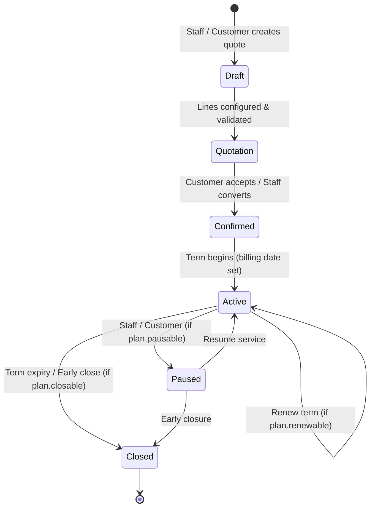
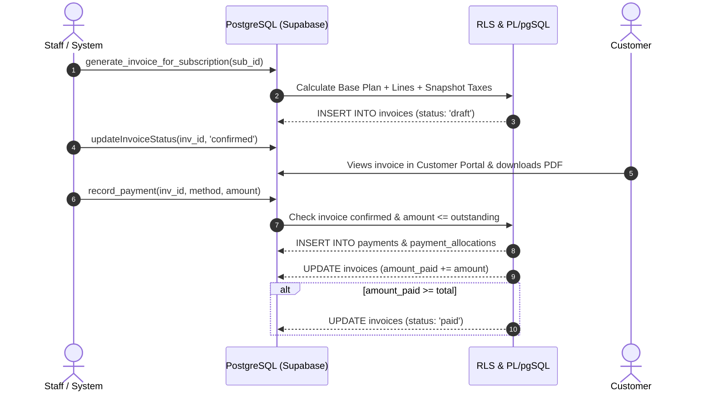

# SubFlow — Enterprise Subscription Management Platform
> **Brightloop Hackathon Project** | Enterprise B2B SaaS Subscription, Quotation, Billing & Multi-Role Operations System

---

## 🚀 Executive Summary

**SubFlow** is a modern, high-performance **Subscription Management & Billing Operations Platform** built specifically for B2B recurring revenue models. It provides a complete three-tier operational ecosystem:

1. **Executive Administration (`/admin`)** — System oversight, staff provisioning, and organizational security.
2. **Operations & Staff Portal (`/staff`)** — End-to-end customer management, quotation builder, subscription lifecycle governance, recurring invoice generation, and transactional payment reconciliation.
3. **Customer Self-Service Portal (`/customer` / `/portal`)** — Secure subscriber dashboard for plan visibility, lifecycle actions (pause/renew/close), downloadable PDF invoices, and transaction histories.

---

## 🛠️ Technology Stack

| Layer | Technology | Key Capabilities |
|---|---|---|
| **Frontend Framework** | **React 19 (JSX) + Vite 8** | Single-Page Application (SPA) with lightning-fast HMR and zero TypeScript bloat |
| **Styling & UI** | **Tailwind CSS v4** | Clean light enterprise UI, custom design tokens, responsive layouts, data tables |
| **Icons & Notifications** | **Lucide React + Sonner** | Consistent iconography and accessible, stacked toast notifications |
| **Routing & Guards** | **React Router v7** | Role-Based Access Control (`ProtectedRoute`, `RoleRoute`) with lazy route splitting |
| **PDF Generation** | **jsPDF** | Client-side pixel-perfect tax invoice and quotation PDF rendering and printing |
| **Database & Storage** | **Supabase PostgreSQL 15** | Relational schema, Sequences, PL/pgSQL Stored Procedures, Triggers |
| **Access Control (Auth & RLS)** | **Supabase Auth + PostgreSQL RLS** | Defense-in-depth security: every table is protected by PostgreSQL Row Level Security |
| **Serverless Computing** | **Supabase Edge Functions (Deno)** | Privileged administrative operations (`invite-staff` / `create-staff`) with JWT verification |

---

## 🌟 Key Innovations & Competitive Edge

Judges should note the following architectural and functional highlights:

1. **True Serverless Full-Stack (Zero Custom Backend Overhead)**
   - No fragile Express/Django middle-tier server required.
   - Business-critical rules (tax math, discount allocation, balance validations, lifecycle state machines) execute directly inside **PostgreSQL `SECURITY DEFINER` functions** for guaranteed ACID transactional integrity.

2. **Database-Level Plan Governance Engine**
   - Plans define business constraints (`closable`, `pausable`, `renewable`, `auto_close`).
   - The database prevents illegal state transitions (e.g., pausing a subscription whose plan forbids pausing, or closing early without permissions), even if a client attempts to bypass the UI.

3. **Guaranteed "Never Billed Twice" Idempotency**
   - Database constraint `UNIQUE (subscription_id, period_start)` on `invoices` mathematically prevents duplicate recurring charges for the same billing cycle.

4. **Dynamic Quotation Builder with Variant Pricing**
   - Quotation generator supporting product variants (e.g., *Brand: Odoo (+560)*), live tax computations, and one-click conversion into confirmed subscriptions.

5. **Client-Side Corporate PDF Engine**
   - Generates and downloads branded, tax-compliant PDF invoices and customer quotations in milliseconds using `jsPDF` without external third-party API dependencies.

6. **Defense-in-Depth Anti-Tampering Triggers**
   - PostgreSQL triggers (`guard_customer_update`, `guard_profile_update`) prevent authenticated users or customers from altering their own `role`, `user_id`, or registered `email`.

---

## 🔄 Technical System Architecture & Flow

### 1. Subscription Lifecycle State Machine



### 2. End-to-End Billing & Payment Flow



---

## 🗄️ Database Schema & Data Model

The schema is built in PostgreSQL with high-precision financial types (`NUMERIC(12,2)`) and strict foreign keys:

### 1. Identity & Profiles
- **`profiles`** — `id (UUID PK -> auth.users)`, `email`, `full_name`, `role (admin, staff, customer)`, `is_active`, `created_at`.
- **`customers`** — `id (UUID PK)`, `user_id (UUID FK -> profiles, nullable)`, `name`, `email (UNIQUE)`, `phone`, `company`, `address`, `created_at`.

### 2. Catalog
- **`taxes`** — `id`, `name`, `rate_type ('percent', 'fixed')`, `rate`, `is_active`.
- **`payment_terms`** — `id`, `name`, `days (INT)`. (e.g., Immediate, Net 15, Net 30).
- **`products`** — `id`, `name`, `type ('service', 'goods', 'software')`, `sales_price`, `cost_price`, `tax_id`, `is_active`.
- **`product_variants`** — `id`, `product_id (FK)`, `attribute_name`, `value`, `extra_price`.
- **`plans`** — `id`, `name`, `price`, `billing_period ('daily', 'weekly', 'monthly', 'yearly')`, `min_quantity`, `closable (bool)`, `pausable (bool)`, `renewable (bool)`, `auto_close (bool)`.
- **`discounts`** — `id`, `name`, `type ('percent', 'fixed')`, `value`, `applies_to ('product', 'subscription')`, `usage_limit`, `times_used`.

### 3. Subscriptions & Quotations
- **`subscriptions`** — `id`, `number (UNIQUE, 'SUB-00001')`, `customer_id (FK)`, `plan_id (FK)`, `status ('draft', 'quotation', 'confirmed', 'active', 'paused', 'closed')`, `start_date`, `expiry_date`, `next_billing_date`, `quotation_valid_until`, `payment_term_id`.
- **`subscription_lines`** — `id`, `subscription_id (FK)`, `product_id (FK)`, `variant_id (FK)`, `quantity`, `unit_price`, `tax_id`, `amount`.
- **`subscription_status_log`** — `id`, `subscription_id`, `from_status`, `to_status`, `changed_by`, `changed_at`.

### 4. Billing & Reconciliations
- **`invoices`** — `id`, `number (UNIQUE, 'INV-00001')`, `subscription_id (FK)`, `customer_id (FK)`, `period_start`, `period_end`, `issue_date`, `due_date`, `status ('draft', 'confirmed', 'paid', 'cancelled')`, `subtotal`, `discount_total`, `tax_total`, `total`, `amount_paid`.
- **`invoice_lines`** — `id`, `invoice_id (FK)`, `kind ('plan_fee', 'product')`, `description`, `quantity`, `unit_price`, `base_amount`, `tax_amount`, `line_total`.
- **`payments`** — `id`, `reference ('PAY-00001')`, `invoice_id (FK)`, `method ('cash', 'bank_transfer', 'card', 'upi', 'cheque', 'other')`, `amount`, `payment_date`, `note`, `recorded_by`.
- **`payment_allocations`** — `id`, `payment_id (FK)`, `invoice_id (FK)`, `amount`.
- **`audit_logs`** — `id`, `user_id`, `action`, `entity_type`, `entity_id`, `details (JSONB)`.

---

## 🔒 Security & Access Matrix

| Resource / Capability | Administrator | Staff | Customer |
|---|:---:|:---:|:---:|
| **Access Admin Console (`/admin`)** | ✅ Full | ❌ Blocked | ❌ Blocked |
| **Invite / Provision Staff** | ✅ Yes (Edge Function) | ❌ Blocked | ❌ Blocked |
| **Customer Directory (View & Create)** | ✅ Full | ✅ Full | ❌ Own row only |
| **Quotation Builder & Conversion** | ✅ Full | ✅ Full | ❌ No access |
| **Subscription Lifecycle (All Accounts)** | ✅ Full | ✅ Full | ❌ Own only (Rule-gated) |
| **Generate & Confirm Invoices** | ✅ Full | ✅ Full | ❌ Own only (Read/PDF) |
| **Record Customer Payments** | ✅ Full | ✅ Full | ❌ Own only (Read receipts) |
| **Edit Product & Plan Configurations** | ✅ Full | 👁️ Read Only | ❌ No access |
| **Modify Own User Role** | ❌ Blocked (Trigger) | ❌ Blocked (Trigger) | ❌ Blocked (Trigger) |

---

## 💻 Project Structure

```
Odoo_Eternals/
├── frontend/
│   ├── src/
│   │   ├── components/
│   │   │   └── ui/             # Reusable UI primitives (Button, Modal, Input, Badge, Table, Skeleton)
│   │   ├── context/            # AuthContext with session persistence & role resolver
│   │   ├── features/
│   │   │   ├── admin/          # Admin Staff Management & Invite modals
│   │   │   ├── auth/           # Login, Register, Forgot Password, Reset Password
│   │   │   ├── customer/       # Customer portal: Overview, Subscriptions, Invoices, Payments, Profile
│   │   │   └── staff/          # Staff workspace: Overview, Customers, Quotes, Subs, Invoices, Payments
│   │   ├── layouts/            # Role-specific layouts: AdminLayout, StaffLayout, CustomerLayout, AuthLayout
│   │   ├── routes/             # AppRoutes, ProtectedRoute, RoleRoute
│   │   ├── services/           # Supabase API services (staffService, customerService, authService)
│   │   └── utils/              # PDF generator (jsPDF), formatters, validators, classnames
│   ├── package.json
│   └── vite.config.js
├── supabase/
│   ├── functions/
│   │   └── invite-staff/       # Admin Edge Function for secure staff provisioning
│   └── migrations/             # Incremental SQL migrations with RLS & PL/pgSQL
├── SPEC.md                     # Technical requirements specification
└── README.md                   # Hackathon submission documentation
```

---

## 🚀 Setup & Installation Guide

### Prerequisites
- Node.js 18+ (tested with Node 20 / 22)
- Supabase account & project

### 1. Clone & Install Dependencies
```bash
git clone https://github.com/abdullahMunawarKhan/Odoo_Eternals.git
cd Odoo_Eternals/frontend
npm install
```

### 2. Configure Environment Variables
Create a `.env` file in `frontend/`:
```env
VITE_SUPABASE_URL=https://your-project-id.supabase.co
VITE_SUPABASE_ANON_KEY=your-anon-key-here
```

### 3. Run Database Migrations
Execute the migrations in your Supabase SQL Editor in numerical order from `supabase/migrations/`:
1. `20261031100000_identity_tables.sql`
2. `20261031100100_new_user_trigger.sql`
3. `20261031100200_identity_rls.sql`
4. `20261031120000_customer_dashboard_schema.sql`
5. `20261031150000_staff_operations.sql`

### 4. Run Development Server
```bash
npm run dev
```

### 5. Production Build
```bash
npm run build
```
*(Transpiled with 0 errors via Vite)*

---

## 🧪 Hackathon Judging & Demo Walkthrough

Follow this 5-minute evaluation flow to test all features:

1. **Public Customer Registration & Auth Flow**
   - Go to `/register` and create a customer account.
   - Enforces password security (uppercase, lowercase, special character, length > 8).
   - Automatically signs in and lands on `/customer`.
   - Verify: Customer can only view their own account data and cannot access `/staff` or `/admin`.

2. **Staff Operational Workspace (`/staff`)**
   - Log in with a staff account.
   - **Overview:** Review live KPI metrics (Customers, Subscriptions, Pending Quotes, Outstanding Invoices, Payments).
   - **Customer 360°:** Open `/staff/customers`, add a customer or view linked history.
   - **Quotation Builder:** Open `/staff/quotations/new`, select a plan and product variants, review real-time tax calculation, and save.
   - **Convert Quote:** View the quotation, click **Convert to Subscription** — instant conversion to a confirmed subscription.
   - **Lifecycle Management:** Open `/staff/subscriptions/:id`. Test Activate, Pause, Resume, and Early Close (respects plan flags).
   - **Billing & Invoice Generation:** Click **Generate Invoice**. View the generated invoice with line-item tax breakdown.
   - **Download PDF:** Click **PDF** to inspect the pixel-perfect generated PDF invoice.
   - **Record Payment:** Click **Record Payment**, choose a payment method (e.g. Bank Transfer), and submit. The invoice automatically updates `amount_paid` and status turns to `Paid`.

3. **Admin Privileges (`/admin`)**
   - Log in with an admin account.
   - View overview KPIs and navigate to `/admin/staff`.
   - Send an invitation via the Edge Function.
   - Verify staff role assignment and security controls.

---

## 👥 Contributors (Team Eternals)

- **Brightloop Software Hackathon 2026**
- Clean Code, Enterprise Architecture, High Reliability.
